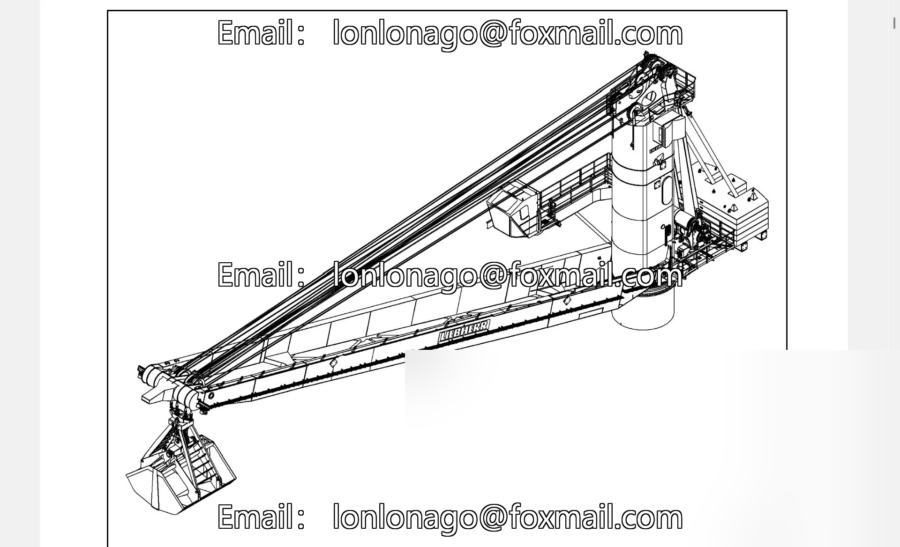
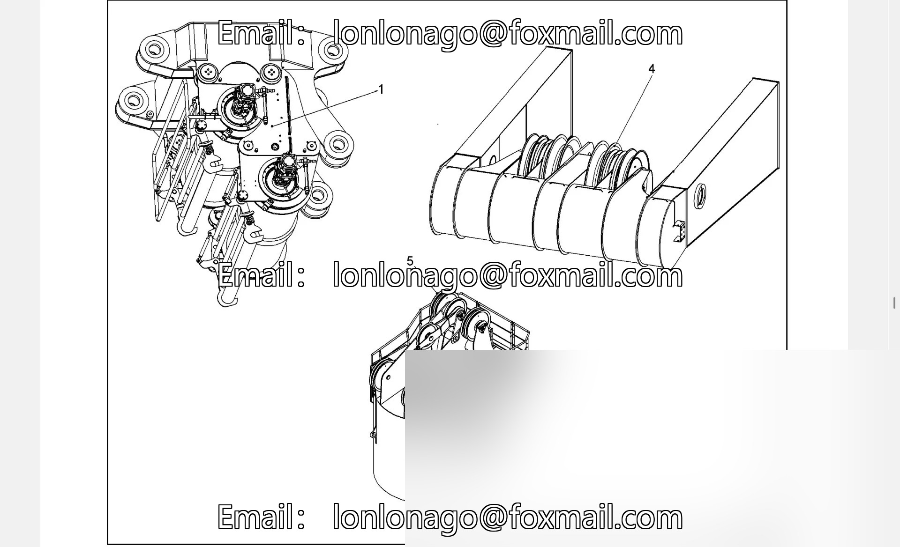
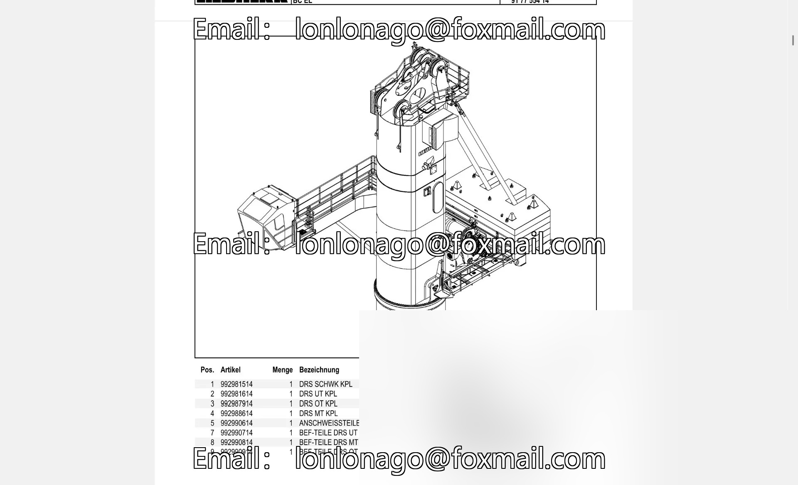
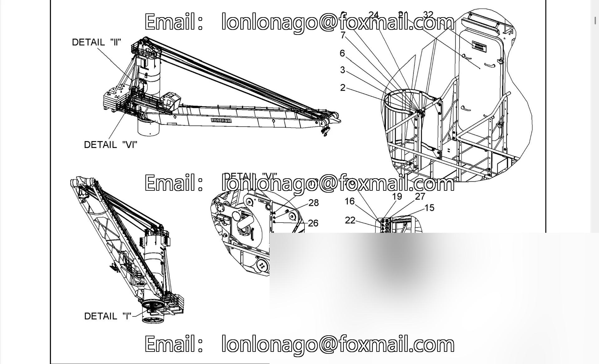

# LIBHERR LIEBHERR FCC-CBG 35/45/56

## Body

LIEBHERR FCC-CBG 35/45/56 LITRONIC Crane Accessories Directory; PDF , 420 pages.
LIEBHERR FCC-CBG 35/45/56 LITRONIC is a series of fixed-mast goods cranes produced by LIEBHERR, designed for material handling in ports, docks, and shipyards.
The series of cranes are widely applied in bulk handling and are especially used in coal loading and unloading operations.
LIEBHERR is an important crane supplier in major coal production areas such as Garibuan in Indonesia.
The FCC/TCC series is known for its modular design and can be flexibly configured according to port infrastructure and customer requirements.
534848470

including detailed parts, accessories, maintenance manuals, and spare parts list, suitable for professional uses such as equipment repair, spare parts procurement, and system maintenance.
The materials are in PDF format, complete, and can be sent directly via network disk link.
Not returned, not exchanged, contact privately if needed.

This is a LITRONIC crane part catalog for Liebherr FCC-CBG 35/45/56, in PDF format, containing detailed parts, accessories, maintenance manuals and spare parts lists, suitable for professional use such as equipment maintenance, spare parts procurement and system maintenance.

<!-- AI_ENRICHED -->

## Images

## Payment

Here is a pay link on Stripe ( https://buy.stripe.com/3cs8yP7sY87d0vu9AB ). Please contact me lonlonago@foxmail.com after funding $89, and I will send you a complete data files , thank you!

